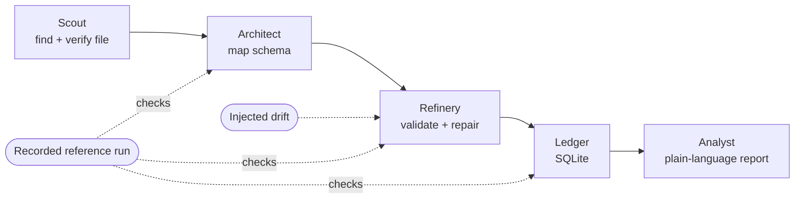

# Team 8: Hospital Price Files, Made Readable

Current implementation and validation status: [STATUS.md](STATUS.md).

**Five AI-assisted stages turn a real hospital's 36.8 MB price-transparency file into a checked SQL ledger and a plain-language report, and the result reproduces exactly on every run.**

Live demo: **[peaaiiteam8.online](https://peaaiiteam8.online)**

---

## Request an account

Email: Brandon.siscoe001@umb.edu

## Why it matters

US hospitals have to publish their negotiated prices as machine-readable files. In practice those files are huge, deeply nested JSON, and every hospital lays them out a little differently. The data is public, but most people can't use it.

We picked one real file, South Shore Hospital's published standard charges, and built a pipeline that finds it, maps it, repairs it, stores it and explains it. Models propose. Deterministic code checks every proposal before anything counts.

## What it does

| Stage | Job | Output |
|---|---|---|
| **Scout** | Finds the hospital's published file and checks it is the exact file we expect. | Verified source file |
| **Architect** | Proposes how the nested JSON maps onto a flat schema. | Field mapping, checked against the recorded reference |
| **Refinery** | Validates every row. When the source drifts, it proposes a repair, and code re-checks the repair. | Clean, validated rows |
| **Ledger** | Writes the rows into a local SQLite ledger. | `mrf.sqlite`, CSV exports |
| **Analyst** | Writes a plain-language report from the stored data. A guard rejects any figure the ledger doesn't support. | `report.md` |



## By the numbers

All figures come from the recorded reference run of the full South Shore Hospital file and from the test suites in this repo.

| | |
|---|---|
| Source file streamed | 36,771,540 bytes |
| Items parsed | 25,451 |
| Ledger rows | 183,335 |
| Rows quarantined | 0 |
| Dollar rates restored after injected drift | 127,887 of 127,887 |
| Comparison groups in the report | 6,938 |
| Groups with a notable price spread | 28 |
| Parse stage time | about 3.6-3.9 s on a laptop |
| Peak memory | about 200-240 MiB, streaming, never the whole file in memory |
| Tests | 210 Python (pytest) + 230 frontend (vitest) |

## What you see in the demo

- A visual canvas. Each stage is a node, and you watch data move from one to the next.
- Per-stage counts, checks and timings while the run is happening.
- An **Upstream schema drift** moment: we break the source on purpose, the Refinery names the failed check, proposes one repair, and the counts go green again.
- The final report: per-code price comparisons across payers, with caveats on small samples.
- Download links for the ledger and report artifacts.

## Run it locally

Requirements: Python 3.10+ and Node.js 18+.

```bash
# Python side
python -m pip install -r requirements.txt -r requirements-dev.txt
python -m pytest -q

# Frontend
cd frontend
npm install
npm test             # vitest suite + registry docs check
npm run dev          # canvas in simulated mode, no account needed
```

Open the URL Vite prints. Add `?demo=1` for a guided storyboard. Simulated mode runs the full canvas with no network calls.

To run the hospital pipeline against the real file on your machine, start the local pipeline server in a second terminal (`npm run pipeline:serve` from `frontend/`). The server listens on localhost only and requires a signed-in session. Without one, the canvas uses the recorded run and says so.

## How we know it's right

- **Recorded reference run.** The full-file run is stored in `fixtures/`, including the generated report. A new run has to reproduce it exactly: same counts, same rows, same report. Any difference fails the run.
- **Injected drift, then repair.** The demo breaks the upstream schema on purpose. The repair counts only if code re-validates every affected row (127,887 of 127,887).
- **Models propose, code decides.** A model's mapping or repair is shown as a proposal until deterministic checks pass. The Analyst's prose is checked against the ledger before it is shown.
- **Tests.** 210 pytest tests cover ingest, mapping, storage, analysis, discovery and the pipeline server. 230 vitest tests cover the canvas, the pipeline panel, the report table and the compiler. `npm run docs:check` keeps generated docs in sync with the code.

## Graceful degradation

If the model, the account service or the network is unavailable, the pipeline falls back to the recorded path and labels it on screen ("model unavailable, recorded path used"). It never presents a recorded result as a live one. Signed-out visitors can explore the canvas but cannot start a server run or an export.

## Tech stack

- **Pipeline:** Python, streaming JSON ingest, SQLite, standard-library HTTP server.
- **Frontend:** React, TypeScript, Vite, React Flow, Framer Motion, Tailwind, Zustand.
- **Tests:** pytest, vitest, Testing Library.
- **Hosting:** Docker Compose behind nginx, served at peaaiiteam8.online.
- **Agents:** model calls run through the team's agent platform. This repo uses only its public workflow API.

## Repo map

```
ingest.py, hospital_mapping.py, mrf_apply.py   streaming parse, mapping, repair
store.py, analyze.py                           SQLite ledger and report
discovery.py                                   Scout: find and verify the source file
server/pipeline_server.py                      local pipeline server used by the canvas
drive_export.py                                optional, explicit export of run artifacts
fixtures/                                      recorded reference run and test slices
contracts/                                     JSON schemas for stage inputs and outputs
tests/                                         pytest suite
frontend/                                      the canvas app (see frontend/README.md)
deploy/                                        container setup for the public site
```

## Limitations

- One hospital so far. The mapping is tuned to South Shore Hospital's layout.
- The Analyst writes a one-shot report. It doesn't take follow-up questions yet.
- Small-sample price comparisons are marked as indicative only.
- The public site is a demo deployment, not a multi-tenant service.

## Next steps

1. **Conversational Analyst.** Ask follow-up questions about the ledger in plain language.
2. **Many hospitals.** Run many hospitals' files, each with its own recorded reference check.
3. **Ledger as a tool.** Let agents query the ledger through a standard connector.
4. **Cross-hospital comparisons.** Compare the same code and payer across hospitals.
5. **Production hardening.** Per-user limits, key rotation and multi-user storage.
6. **Cloud exports.** Send ledger and report artifacts straight to shared drives.

## Team

Team 8, peaaii-team-gods.
